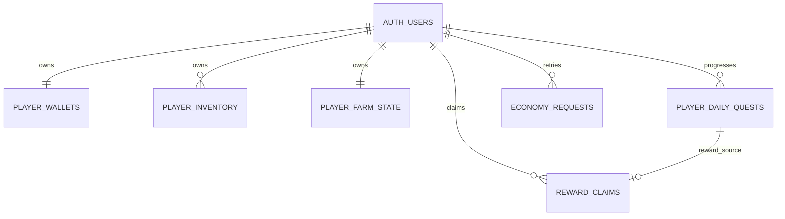

# Giai đoạn 2 — Thiết kế giữ chân người chơi

**Trạng thái:** đã có các migration 001–012 theo kết quả đã gửi từ người dùng. Người dùng yêu cầu nhập save cũ hiện có; migration 013 là bổ sung mới, chưa chạy và chưa xác minh staging/production. Kết quả postflight trước đó chỉ xác nhận cấu trúc/grants, không xác nhận nghiệp vụ.

## 1. Kết quả rà soát mã hiện có

- `outputs/index.html` đã có ba nhiệm vụ ngày: gieo hạt, thu hoạch cây và cho vật nuôi ăn. Tiến độ, cờ đã nhận và phần cộng xu/XP đều đang xử lý ở client trong `s.dailyBoard`, `dailyProgress()` và `renderJournal()`.
- Cùng file có nhiệm vụ NPC hạng B/A/S/SS (`visitorQuestDefs`, `visitorState()`). Trạng thái, điều kiện hoàn thành và cấp xu/XP/hạt/con giống nằm trong save client.
- `s.collections` đang đếm cây và sản phẩm đã thu hoạch. Nhật ký hiển thị các mục này; chưa có chuỗi thành tích hoặc phần thưởng sưu tập.
- `outputs/supabase-game-saves.sql` cấp cho `authenticated` quyền đọc/ghi trực tiếp hàng `game_saves` của chính họ. RLS giới hạn đúng `user_id`, nhưng `save_data` do client cung cấp nên không xác thực tính hợp lệ của tiền, kho, XP hoặc quest.
- `outputs/supabase-marketplace.sql` có RPC giao dịch chợ và khóa hàng/save trong giao dịch; RPC hiện thao tác tiền và kho bên trong `game_saves.save_data`, nên cần được chuyển cùng nguồn dữ liệu kinh tế nếu tách canonical state.
- `outputs/android-app/app/src/main/assets/www/index.html` là bản HTML đóng gói Android có mã nhiệm vụ/nhật ký riêng. Khi triển khai sau này, web và tài nguyên Android phải được cập nhật đồng bộ, rồi đóng gói APK/AAB tương ứng.
- Chưa thấy migration riêng, Edge Function, bảng điểm danh, đơn hàng, thành tích hay hồ sơ xã hội. Đây là rà soát mã cục bộ; chưa chứng minh schema đang triển khai thực tế giống các file SQL.

## 2. Nguồn dữ liệu chuẩn và ranh giới bảo mật

### Nguồn chuẩn đề xuất

| Dữ liệu | Nguồn chuẩn sau khi chuyển đổi | Vai trò của client |
|---|---|---|
| Xu | `player_wallets.coins` | Hiển thị cache; không gửi số xu mới để máy chủ ghi nhận. |
| XP và cấp | `player_wallets.xp`; cấp được tính ở máy chủ từ XP | Hiển thị cache. Không cho client tự quyết định XP/cấp. |
| Hạt giống, thức ăn, nông sản, sản phẩm | `player_inventory` theo `user_id,item_key` | Chỉ gửi yêu cầu hành động; máy chủ kiểm tra và trừ/cộng. |
| Luống, thời điểm gieo, vật nuôi, trạng thái sản phẩm | `player_farm_state` do RPC máy chủ cập nhật | Client gửi ý định như gieo/thu hoạch/cho ăn, không gửi trạng thái kết quả để tin theo. Thời gian dùng đồng hồ DB. |
| Tiến độ nhiệm vụ ngày | `player_daily_quests` | Client chỉ đọc và hiển thị. Chỉ hành động hợp lệ ở máy chủ mới tăng tiến độ. |
| Thưởng đã nhận và kết quả request | `reward_claims` | Client cung cấp UUID request; máy chủ tự xác định phần thưởng và kết quả. |
| `s.collections` hiện tại | Giữ nguyên như dữ liệu lịch sử trong save hiện hữu | Không tự động chuyển thành tiến độ server hoặc đổi thành thưởng. Có thể tiếp tục hiển thị phần cũ cho tới khi có chính sách chuyển đổi riêng. |

### Revision không phải xác thực kinh tế

- Revision/CAS chỉ trả lời: “save nào mới hơn?” Nó chặn một ảnh chụp cũ ghi đè ảnh mới nếu mọi đường ghi đi qua RPC CAS.
- Revision không chứng minh số xu, kho, XP, cây chín, vật nuôi đã ăn, nhiệm vụ hoàn tất hay phần thưởng hợp lệ.
- Không nhận `coins`, `xp`, `inventory`, `progress`, `reward` hoặc thời điểm thu hoạch từ client như giá trị có thẩm quyền.
- Giao dịch kinh tế phải đọc và khóa trạng thái canonical, kiểm tra điều kiện ở server, cập nhật mọi bảng liên quan trong **một transaction**, rồi lưu kết quả idempotency trước khi commit.
- Nếu request trả về timeout sau commit, client gửi lại cùng UUID và nhận lại kết quả đã lưu; không cộng lại tài nguyên.

### Xử lý bản lưu cũ

`game_saves.save_data` đã từng được ghi từ client; do đó không thể chứng minh hồi tố rằng số dư, kho hoặc thời điểm trong snapshot là hợp lệ. Theo yêu cầu mới của người dùng, migration 013 nhập đúng snapshot đang lưu trên máy chủ cho chính tài khoản đã đăng nhập. Đây là chấp nhận snapshot cũ làm số dư khởi điểm một lần, không phải xác minh lịch sử kinh tế. RPC không nhận save từ trình duyệt, khóa hàng máy chủ, không ghi đè canonical đã tồn tại, và giữ nguyên toàn bộ JSON gốc trong `player_farm_state.farm_state.legacy_save` cùng hàng `game_saves`. Không chuyển `s.collections`, quest lịch sử hoặc dữ liệu đó thành tiến độ/thưởng hồi tố. Cây đang sinh trưởng và lượt vật nuôi đang tạo sản phẩm được khởi động lại bằng giờ máy chủ để timestamp từ client không thể mở khóa thu hoạch ngay.

Trước cutover cho tài khoản hiện hữu cần quyết định chính sách chuyển đổi: đối soát bằng dữ liệu có thể xác minh, cấp mức khởi tạo có giới hạn đã công bố, hoặc giữ tài khoản ở trạng thái chờ xử lý. Chưa có bằng chứng để chọn hoặc thực hiện phương án nào. Không được âm thầm xóa save cũ.

## 3. Múi giờ ngày và tuần

**Đề xuất: dùng `Asia/Ho_Chi_Minh` cho chu kỳ ngày/tuần.** Người chơi mục tiêu ở Việt Nam sẽ thấy ngày mới lúc 00:00 giờ Việt Nam; dùng UTC sẽ đổi ngày lúc 07:00 giờ Việt Nam và dễ gây nhầm lẫn. `Asia/Ho_Chi_Minh` là tên múi giờ IANA do PostgreSQL/tzdata xử lý; thiết bị người chơi không quyết định ngày. Lưu timestamp giao dịch bằng `timestamptz` UTC, còn khóa chu kỳ là `date` theo múi giờ này.

- Ngày: `timezone('Asia/Ho_Chi_Minh', transaction_timestamp())::date`.
- Tuần: ngày bắt đầu thứ Hai lúc 00:00 theo `Asia/Ho_Chi_Minh` (tuần ISO); lưu ngày thứ Hai đó làm `week_start`.
- Điểm danh, refresh quest, hết hạn đơn và quyết định cây chín đều dùng giờ máy chủ. Không dùng đồng hồ thiết bị, `Date.now()` client, hoặc timestamp do client gửi.
- Múi giờ là quy tắc sản phẩm cố định cho game Việt Nam; đổi nó về sau cần version hóa chu kỳ để không tạo hai lượt/ngày hoặc mất lượt.

## 4. Sơ đồ dữ liệu tối thiểu đề xuất

Các FK về `auth.users(id)` dùng `ON DELETE CASCADE`, nhưng chỉ được bật sau khi quy trình xóa tài khoản được thiết kế và kiểm tra ở staging. Việc xóa tài khoản không thuộc migration đầu tiên.

### Bảng và quyền dự kiến

| Bảng | Khóa/unique và trường server-only | Đọc/ghi, RLS, transaction |
|---|---|---|
| `player_wallets` | `user_id` PK/FK; `coins >= 0`, `xp >= 0`; `revision`, `updated_at` | RLS bật; `authenticated` chỉ SELECT hàng của `auth.uid()`. Không cấp INSERT/UPDATE/DELETE cho `anon` hoặc `authenticated`. RPC được tin cậy là đường ghi duy nhất. Xu/XP/revision do server quyết định. |
| `player_inventory` | PK `(user_id,item_key)`; `quantity >= 0`; item key phải thuộc catalog server | RLS bật; đọc hàng của chính mình; cấm ghi trực tiếp. Mọi thay đổi kho nằm cùng transaction với wallet/farm/order/reward tương ứng. |
| `player_farm_state` | `user_id` PK/FK; farm state phiên bản hóa; `revision`, timestamp gieo/cho ăn/sẵn sàng do server | RLS bật; chỉ đọc hàng của chính mình; cấm ghi trực tiếp. Máy chủ kiểm tra cấp mở khóa, số lượng vật nuôi, thời gian tăng trưởng và điều kiện tương tác. |
| `player_daily_quests` | PK `(user_id,period_date,quest_id)`; `period_date` do server tính theo HCM; `progress`, `target`, `claimed_at`, reward snapshot đều server-only | RLS bật; chỉ SELECT own rows. Không nhận progress/target/status từ client. Hành động hợp lệ cập nhật progress trong transaction của action đó. |
| `economy_requests` | PK `(user_id,request_id)` UUID; lưu `operation_type`, hash payload chuẩn hóa và response đã xác nhận | RLS bật; không có quyền DML client. Mọi RPC thay đổi trạng thái dùng chung ledger idempotency này; retry đồng thời cùng UUID chờ transaction đầu, cùng payload thì trả response cũ, payload khác thì từ chối. Ghi ledger trong cùng transaction với hiệu ứng. |
| `reward_claims` | UNIQUE `(user_id,reward_kind,period_key,source_id)`; chống claim cùng phần thưởng kể cả khi client tạo UUID mới | RLS bật; không có quyền DML client; đọc trạng thái qua RPC. Tách tính duy nhất theo nghiệp vụ khỏi request retry. |
| `game_saves` hiện tại | Giữ nguyên cấu trúc và dữ liệu trong giai đoạn chuyển đổi; revision mới chỉ có ý nghĩa nếu direct write bị thay bằng CAS RPC | Chưa đổi quyền ở migration nền. Khi cutover, tách trường phi kinh tế được phép ghi khỏi canonical state; không cho client cập nhật JSON chứa giá trị kinh tế. |

Mọi `SECURITY DEFINER` dự kiến phải có `search_path` cố định/rỗng và gọi các đối tượng bằng tên schema đầy đủ; `REVOKE EXECUTE ... FROM PUBLIC, anon`, sau đó chỉ `GRANT EXECUTE` cho `authenticated` trên RPC người chơi. Hàm nội bộ dùng trong một transaction không được cấp trực tiếp cho client. RPC phải xác nhận `auth.uid()` khác NULL và luôn lấy `user_id` từ JWT, không nhận user id tin cậy từ payload.

### RPC đề xuất và hiệu lực

| RPC | Quyền gọi | Thao tác và transaction |
|---|---|---|
| `get_my_game_state_v2()` | `authenticated` | Chỉ trả trạng thái canonical của `auth.uid()`, không đọc save người khác. Không ghi. Các trường tiền/kho/XP trả về là projection từ bảng server-owned. |
| `get_my_daily_quests_v2()` | `authenticated` | Tính `period_date` ở DB; tạo/đọc 3 quest ngày cố định từ server definition; chỉ trả tiến độ và trạng thái của chính tài khoản. Nếu tạo row khi đọc thì đây là RPC ghi có kiểm tra quyền, không phải hàm `STABLE`. |
| `plant_crop_v2(request_id, plot_id, crop_id)` | `authenticated` | Dedupe request; khóa farm/inventory; kiểm tra ô mở, loại hạt, số lượng, trạng thái ô; trừ hạt, đặt `planted_at` server và tăng quest gieo nếu hợp lệ. Commit cùng nhau. |
| `harvest_crop_v2(request_id, plot_id)` | `authenticated` | Dedupe; khóa farm/inventory/wallet/quest; kiểm tra crop hiện có và `DB time >= planted_at + duration`; thêm đúng sản phẩm/XP, xóa cây, cập nhật quest và ledger nguyên tử. Không nhận loại cây, số lượng thưởng hoặc XP từ client. |
| `feed_animals_v2(request_id, animal_zone)` | `authenticated` | Dedupe; khóa farm/inventory; kiểm tra khu mở, số vật nuôi, đúng loại thức ăn và đủ kho; trừ thức ăn, đặt thời gian sản phẩm theo DB, tăng quest cho ăn trong cùng transaction. |
| `claim_daily_quest_v2(request_id, quest_id)` | `authenticated` | Tính ngày HCM; khóa row `(user_id,period_date,quest_id)`; chỉ cho claim nếu progress server đạt target và chưa có ledger; dùng reward definition phía server; cập nhật wallet/inventory, claimed state và response ledger nguyên tử. |
| `save_farm_preferences_v2(payload,expected_revision)` | `authenticated` | Chỉ dành cho whitelist trường phi kinh tế. CAS so sánh revision rồi cập nhật; mismatch trả conflict và không ghi. Không nhận wallet, inventory, farm action, quest, collection hoặc reward. |

Các RPC `plant/harvest/feed` chỉ là lát cắt đủ để ba quest ngày hiện tại hoạt động an toàn. Trước cutover toàn game, phải đưa tất cả đường thay đổi kinh tế (mua hạt/thức ăn/con giống, bán, chế biến, thu sản phẩm vật nuôi, chợ marketplace, thưởng NPC, v.v.) sang cùng canonical state và transaction. Không để một luồng cũ ghi lại số xu/kho từ `game_saves` sau khi đã chuyển một phần.

## 5. Migration tối thiểu và rollout

### Mốc A — migration nền tảng + quest ngày (dark launch)

Một migration reviewable, chỉ áp dụng staging sau phê duyệt:

1. Đã tạo draft migration thêm các bảng `player_wallets`, `player_inventory`, `player_farm_state`, `daily_quest_catalog`, `player_daily_quests`, `economy_requests`, `reward_claims`, index/FK/check constraints và RLS. Các FK dùng `ON DELETE RESTRICT` cho tới khi có quy trình xóa tài khoản.
2. Đã thêm catalog cố định cho ba nhiệm vụ ngày hiện có. RPC `get_my_daily_quests_v2()` chỉ xác định ngày máy chủ HCM và đọc/khởi tạo hàng hiển thị của người đang đăng nhập; không tăng tiến độ hay trao thưởng.
3. Đã tạo draft RPC `claim_daily_quest_v2()` với request idempotency, khóa quest, domain ledger và cộng ví trong transaction. Claim sẽ từ chối nếu wallet chưa canonical hoặc tiến độ server chưa đủ. Các RPC gieo/thu hoạch/cho ăn chưa được tạo vì chưa có state canonical khởi tạo và client chưa chuyển hành động sang máy chủ. Không cấp browser role quyền DML.
4. Chỉ nhập snapshot cũ theo migration 013 khi chủ tài khoản chủ động bấm chuyển; không sửa/xóa hàng `game_saves`; giữ nguyên dữ liệu `s.collections` trong snapshot nhưng không backfill tiến độ hay thưởng.
5. Người dùng đã chạy migration trên staging và gửi postflight RLS/table-grants/routine grants. Quyền cơ bản đạt kỳ vọng theo kết quả được gửi; chưa chạy kiểm thử hành vi. Production chưa xác minh.

### Mốc B — client cutover, sau khi được duyệt riêng

- Thay đường đọc/ghi kinh tế và daily journal trong `outputs/index.html` và `outputs/android-app/app/src/main/assets/www/index.html` bằng RPC phiên bản mới.
- Cập nhật marketplace RPC cùng lúc để nó dùng `player_wallets`/`player_inventory`, không `game_saves.save_data`.
- Có version gate/compatibility plan cho APK cũ trước khi thu hồi REST insert/update `game_saves`; nếu không, bản cũ có thể tiếp tục ghi snapshot kinh tế cũ.
- Chỉ bật daily rewards cho tài khoản đã khởi tạo state canonical. Không hiển thị claim thành công trước khi server xác nhận.

### Mốc C — quyết định xử lý tài khoản cũ

Trước khi chuyển người chơi hiện tại, chọn và công bố một chính sách reconciliation. Không migration nào được tự động coi `game_saves` là nguồn tiền hợp lệ. Bảo toàn raw save/backup và có báo cáo số lượng trước/sau. Mốc này cần quyết định sản phẩm và kế hoạch hỗ trợ người chơi; chưa được quyết định ở tài liệu này.

### Rollback

- Trước cutover: tắt feature flag/RPC mới; bảng mới không được sử dụng, giữ nguyên để kiểm tra hoặc chạy lại migration. Không drop bảng có dữ liệu.
- Sau cutover: rollback client chỉ khi đã chứng minh client cũ không thể ghi đè canonical state. Giữ bảng/ledger mới; không hợp nhất ngược các số kinh tế vào JSON cũ một cách tự động.
- Khôi phục từng tài khoản từ snapshot cần so sánh revision và audit ledger; không restore toàn bảng từ backup rồi làm mất giao dịch mới.
- Migration được chạy đúng một lần qua migration history trên staging; file dùng transaction để nếu lỗi thì DDL và seed catalog rollback cùng nhau. Không chạy lại mù quáng sau trạng thái không rõ. Mỗi lần triển khai có preflight/postflight read-only. Bất kỳ thay đổi production nào cần phê duyệt riêng.

## 6. Múi giờ và hành vi idempotency cho các tính năng sau

- **Quest ngày:** unique theo `(user_id,period_date,quest_id)`; claim thêm unique domain key trong reward ledger. UUID request chống retry cùng thao tác; unique domain key chặn dùng UUID khác để claim lại.
- **Quest tuần:** `week_start` thứ Hai HCM; unique `(user_id,week_start,quest_id)`; cùng cơ chế claim ledger.
- **Điểm danh:** unique `(user_id,checkin_date)` và unique `(user_id,request_id)`; streak được tính từ các ngày server đã ghi, không từ con số client gửi.
- **Đơn hàng:** `player_orders.id` UUID; chuyển trạng thái `open -> fulfilled/expired` dưới `SELECT ... FOR UPDATE`; unique fulfilment `(user_id,order_id)` và request UUID. Trừ kho, trả xu/XP và đánh dấu đơn hoàn tất trong một transaction.
- **Thành tích:** unique `(user_id,achievement_id)` cho lần mở khóa; ledger riêng cho lần nhận thưởng. Tiến độ chỉ nhận từ event/action phía server; dữ liệu `s.collections` lịch sử không tự tạo unlock hoặc reward.
- **Tặng quà tương lai:** unique sender/recipient/request; giới hạn ngày có khóa theo `(sender_id,local_date)` hoặc bucket quota row được cập nhật transactionally. Kiểm tra quan hệ bạn bè, item và giới hạn ở server.

Khi RPC dùng `request_id`, client tạo UUID một lần cho hành động người chơi bấm và giữ nguyên UUID qua retry cho tới khi nhận kết quả rõ ràng. Không tạo UUID mới chỉ vì request timeout. Máy chủ chuẩn hóa payload và lưu hash cùng `operation_type`; tái sử dụng UUID cho loại thao tác hoặc payload khác phải bị từ chối. Máy chủ ghi kết quả cuối vào ledger cùng transaction; lỗi trước commit rollback cả hiệu ứng và ledger. Với cùng request đồng thời, khóa duy nhất tuần tự hóa cạnh tranh; nếu transaction đầu commit, lần gọi sau trả response đã lưu; nếu transaction đầu rollback, lần gọi sau được phép thực hiện đúng một lần.

## 7. Test case và tiêu chí nghiệm thu

| Kiểm thử staging | Kết quả bắt buộc |
|---|---|
| Gửi lại cùng `request_id` sau khi server đã commit | Trả cùng response; xu/kho/progress chỉ đổi một lần. |
| Hai thiết bị cùng claim một quest bằng cùng UUID | Một transaction tạo claim; thiết bị còn lại nhận response đã lưu. |
| Hai thiết bị claim cùng quest bằng UUID khác nhau | Unique domain key/row lock cho phép tối đa một reward. |
| Mất mạng trước commit | Không có một phần thay đổi; retry có thể thực hiện đúng một lần. |
| Mất mạng sau commit nhưng trước response | Retry trả kết quả đã ghi, không lặp tác động. |
| Save preferences dùng revision cũ | RPC trả conflict, không ghi đè; client tải trạng thái mới và yêu cầu xử lý conflict. Không tự merge tiền/kho. |
| Người dùng anon hoặc user A gọi dữ liệu/claim của user B | Không có quyền EXECUTE cho anon; authenticated chỉ đọc/thay đổi dữ liệu theo `auth.uid()`. |
| User thường gọi RPC admin hoặc cố DML trực tiếp lên bảng canonical | Bị từ chối; không có side effect. |
| Kho thiếu hạt/thức ăn/nông sản khi action/order | RPC từ chối; wallet, inventory, farm state, quest progress và ledger không đổi. |
| Gửi progress/target/reward/coins giả trong payload | Tham số bị bỏ qua hoặc RPC từ chối; server dùng catalog và state riêng. |
| Gieo/thu hoạch/cho ăn hợp lệ | Chỉ action thành công tăng đúng quest; timer dùng DB time. |
| Qua 00:00 hoặc thứ Hai theo HCM; đổi múi giờ thiết bị | Một chu kỳ mới đúng giờ Việt Nam; đổi giờ thiết bị không đổi eligibility. |
| Chạy migration hai lần và rollback dark launch | Không mất/chuyển đổi `game_saves` hoặc `s.collections`; không duplicate schema object; dữ liệu dark-launch còn nguyên. |

### Điều kiện nghiệm thu trước khi bật nhiệm vụ ngày

1. Xu, XP, inventory/seeds, farm action state, quest progress và reward có nguồn chuẩn server rõ ràng.
2. Không còn đường client trực tiếp ghi các trường canonical; RPC có RLS/EXECUTE đúng như thiết kế.
3. Plant/harvest/feed và claim cùng cập nhật state/progress/reward trong transaction, có request idempotency và domain uniqueness.
4. Revision conflict được kiểm thử riêng và không được dùng làm bằng chứng hợp lệ cho kinh tế.
5. Web và Android gọi cùng API/schema; bản Android cũ có chính sách tương thích trước khi thu hồi quyền ghi.
6. `s.collections` và toàn bộ save lịch sử được giữ nguyên; chưa có chuyển đổi hoặc thưởng lịch sử tự động.
7. Các test trong bảng chạy pass trên staging; production chưa được đụng tới khi chưa phê duyệt.

## 8. Vấn đề còn chưa giải quyết

1. **Chính sách chuyển đổi save cũ:** không có nguồn lịch sử độc lập để xác minh xu/kho/XP đã được client gửi trước đây. Cần quyết định cách đối soát cho tài khoản hiện hữu.
2. **Cutover các đường kinh tế:** marketplace hiện sửa `game_saves`; shop, crop, animal, processing và phần thưởng NPC cũng có logic client. Cần lập danh mục mọi mutation và chuyển đồng bộ trước khi khóa REST write.
3. **Lưu offline:** cần quyết định offline chỉ cho phép chơi cache chưa xác thực hay chặn hành động kinh tế cho đến khi đồng bộ. Hành động offline không thể tự nhận thưởng có giá trị trước khi server xác thực.
4. **Phiên bản app:** chưa có version gate cho APK cũ; thu hồi quyền save trực tiếp có thể làm bản cũ không đồng bộ được.
5. **Tài khoản xóa và retention:** FK cascade có thể xóa state liên quan; cần quy trình xác nhận, thông báo và kiểm thử xóa ở staging trước khi dùng cascade trong migration.
6. **Môi trường:** chưa xác minh schema đang chạy, migration đã áp dụng hay kết quả staging. Tệp SQL địa phương không chứng minh trạng thái Supabase.

## 9. Thứ tự thực hiện sau khi thiết kế được duyệt

1. Chốt chính sách dữ liệu tài khoản cũ, offline và phiên bản APK.
2. Rà hết luồng kinh tế ở web/Android và vẽ API cutover để không còn writer cũ.
3. Review migration nền tảng/quest ngày trên giấy; kiểm tra quyền và rollback.
4. Chỉ sau phê duyệt mới tạo migration file và áp dụng trên staging; chạy test cạnh tranh/idempotency/RLS.
5. Cutover client web + Android và marketplace; giữ feature flag tắt cho người chơi thật tới khi staging pass.
6. Bật nhiệm vụ ngày; sau ổn định mới thiết kế tuần, điểm danh, đơn hàng, thành tích. Bảng xã hội để giai đoạn sau.

**Chưa được xác nhận:** trạng thái staging, production, RLS đã triển khai, data counts, hoặc migration behavior. Cần kết quả kiểm tra thật trước khi chuyển bước.

## 10. Trạng thái triển khai cục bộ sau khi được duyệt

- Đã tạo `outputs/migrations/20261019_001_phase2_foundation.sql`, `outputs/migrations/20261019_002_claim_daily_quest_v2.sql` và `outputs/migrations/README-phase2-foundation.md`.
- Đây là migration additive/dark-launch; không thay đổi game client hoặc dữ liệu cũ. Theo postflight người dùng gửi, bảng/RPC tồn tại và quyền cơ bản đạt kỳ vọng; chưa có xác minh độc lập, kiểm thử hành vi hoặc kiểm tra production.
- RPC đọc ngày và claim an toàn đã có trong draft nhưng chưa được game gọi. Tiến độ nhiệm vụ hiện tại vẫn chạy theo client cũ cho tới khi có RPC hành động an toàn và một cutover đồng bộ web/Android.
- Đã soạn migration draft `outputs/migrations/20261019_003_new_player_bootstrap_and_plant_v2.sql`: bootstrap chỉ cho tài khoản không có hàng `game_saves`; thêm RPC cuốc đất và gieo hạt có server time/config, kho, XP, quest ngày, revision và idempotency. Migration phụ thuộc `game_saves` và `game_global_config`, chưa chạy và chưa kiểm thử PostgreSQL/staging.
- Bootstrap từ chối tài khoản có legacy save; không import hoặc sửa `s.collections`. Đây là hàng rào an toàn, không phải phương án chuyển tài khoản hiện hữu. UI web/Android vẫn chưa nối RPC mới.
- Người dùng đã chạy migration 003 trên staging và gửi postflight: RLS bật cho 8 bảng; authenticated chỉ có SELECT trên bốn bảng riêng tư; ba RPC mới có EXECUTE cho authenticated. Chưa có behavior tests; không có xác minh staging độc lập.
- Đã soạn migration draft `outputs/migrations/20261019_004_crop_water_harvest_v2.sql` cho tưới/thu hoạch với idempotency, timestamp server, kho, XP, tiến độ nhiệm vụ ngày và revision. Chưa chạy và chưa kiểm thử.
- Người dùng yêu cầu hoãn tạo test account/kiểm tra hành vi tới sau; vì vậy không áp dụng migration 004 lên staging hoặc nối RPC vào game trước khi kiểm thử được thực hiện. Dữ liệu save cũ vẫn không bị đụng tới.
- Đã soạn migration draft `outputs/migrations/20261019_005_shop_purchase_v2.sql` cho mua hạt giống/thức ăn bằng ví và kho canonical. Giá và quyền mở khóa do server xác định; request idempotent. Chưa chạy/kiểm thử và chưa nối cửa hàng client.
- Đã soạn migration draft `outputs/migrations/20261019_006_animal_actions_v2.sql` cho mua từng biến thể, cho ăn và thu sản phẩm vật nuôi. Catalog có 22 biến thể theo cửa hàng, mua lẻ, tối đa 8 con/loài. Feed tiêu hao một đơn vị mỗi con và chụp số lượng lứa; mua thêm khi đang chờ không sửa lứa hiện tại. Thu hoạch ghi `eggs`/`pork`/`milk`/`fish` vào kho canonical.
- Migration 006 vẫn draft; chưa chạy, chưa kiểm thử cú pháp PostgreSQL/hành vi, chưa nối client, và chỉ được xem xét sau khi staging behavior tests cho migrations 003-005 đạt. Không chạy SQL trên staging/production và không sửa game client trong bước này.
- Trước cutover còn phải quyết định server-side quy tắc mùa cho vật nuôi: game hiện mô phỏng mùa/ngày ở client, trong khi RPC dự kiến dùng thời gian thực và chỉ dùng `animalHarvestSeconds` × `animalTimeMultiplier`. Không nhận mùa/ngày hoặc ready timestamp từ client.
- Đã soạn migration draft `outputs/migrations/20261019_007_daily_checkin_v2.sql`, tái dùng `player_wallets`, `player_inventory`, `economy_requests` và `reward_claims`; bổ sung catalog phần thưởng 7 ngày và bản ghi check-in theo ngày HCM. Mất ngày thì chuỗi về ngày 1; claim ngày một lần; UUID retry và cạnh tranh hai thiết bị được xử lý phía server.
- Migration 007 chưa chạy/kiểm thử và chưa nối UI. Không backfill streak/phần thưởng lịch sử; không dùng đồng hồ thiết bị; catalog ngày 1–7 là giá trị khởi tạo có thể cần cân bằng trước khi bật.
- Đã soạn migration draft `outputs/migrations/20261019_008_daily_produce_orders_v2.sql`: gán ba đơn/ngày từ template theo cấp và ngày HCM, chụp giá thưởng lúc tạo đơn, giao hàng bằng kho canonical và ghi xu/XP/order/reward ledger atomically. Không dùng dữ liệu lịch sử hay số liệu do client gửi để quyết định giao dịch.
- Migration 008 chưa chạy/kiểm thử/chưa nối client. Bảng đơn giữ lịch sử ngày cũ; hết hạn tự nhiên theo `order_date`. Giá sản phẩm căn cứ `game_global_config`; khi config thay đổi đơn trong ngày không đổi. Cần kiểm tra staging behavior trước khi bật.
- Đã soạn migration draft `outputs/migrations/20261019_009_weekly_quest_chain_v2.sql` cho chuỗi bốn nhiệm vụ tuần. Tiến độ tính từ các RPC server đã commit trong `economy_requests`, tuần bắt đầu thứ Hai HCM, và bước kế tiếp chỉ đếm hành động sau khi bước trước được claim.
- Migration 009 chưa chạy/kiểm thử/nối UI. Không thể tạo tiến độ cho thao tác chưa chuyển sang RPC server; phần này chỉ hoạt động đầy đủ sau khi các hành động liên quan đã được triển khai và kiểm thử staging.
- Đã soạn migration draft `outputs/migrations/20261019_010_achievements_v2.sql` cho thành tích với tiến độ từ ví canonical hoặc các RPC server đã commit; claim thưởng idempotent. Không dùng/import `s.collections` hoặc save lịch sử. Migration có index cho truy vấn progress ledger.
- Migration 010 chưa chạy/kiểm thử/nối UI. Cần chốt chính sách lưu trữ/archival cho `economy_requests` trước khi xóa ledger cũ; tiến độ chưa snapshot có thể phụ thuộc các dòng ledger đó.
- Đã soạn migration draft `outputs/migrations/20261019_011_collection_book_v2.sql` cho 11 cây, 22 biến thể vật nuôi và 4 sản phẩm. Sổ chỉ ghi phát hiện từ event RPC thành công sau `activated_at`; không đọc/chuyển đổi/trả thưởng từ `s.collections` hay event cũ.
- Migration 011 chưa chạy/kiểm thử/nối UI. Việc mở mục vật nuôi phụ thuộc migration 006 và việc mở các loại sản phẩm phụ thuộc RPC thu hoạch vật nuôi.
- Rà soát gộp phát hiện migration 002 hiện khóa quest trước wallet; action RPC khóa wallet trước quest. Đã soạn follow-up migration 012 để thống nhất thứ tự `request -> wallet -> quest` và giữ idempotency qua nửa đêm. Chưa áp dụng; migrations 004-012 chưa chạy theo thông tin hiện có.
- Đã thêm rollout checklist tổng hợp vào `outputs/migrations/README-phase2-foundation.md`. Không nối client hoặc khuyến nghị chạy 004-012 trước khi behavior test 001-003 và các action RPC staging đạt.
